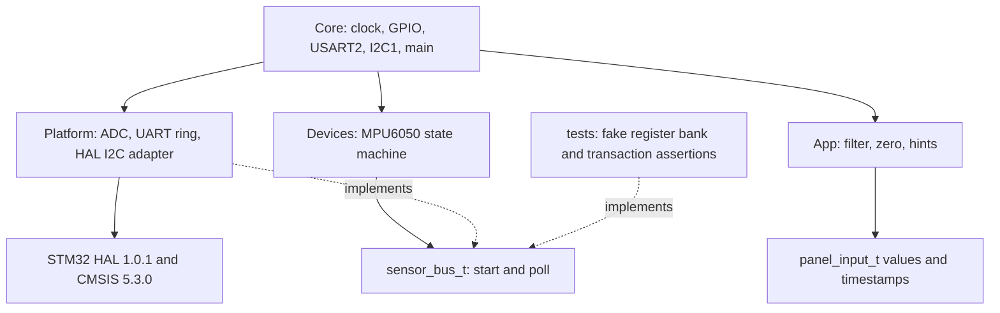

# Архітектура SunAlign

App і Devices не включають HAL, Core або Platform. `tools/check_architecture.py` перевіряє include й апаратні ідентифікатори. `make test` запускає цю перевірку та компілює portable C окремим host GCC. Main є composition root, де поєднуються драйвер, адаптер і логіка.

Драйвер опитує WHO_AM_I, записує PWR_MGMT_1=0, CONFIG=3, ACCEL_CONFIG=0, витримує 100 мс через deadline і читає 6 байтів кожні 100 мс. Після помилки він відкидає дані, чекає 1 с та повторює ID. Callback bus.poll повертає PENDING або остаточний статус; платформний watchdog 20 мс завершує завислий transfer і скидає I²C перед повторним використанням буфера. Busy периферії також підлягає watchdog.

HAL 1.0.1 Mem_Read_IT містить синхронне очікування TC у фазі адреси регістра. У первинному Wokwi-запуску ця фаза не завершилася. Адаптер використовує HAL_I2C_Master_Transmit_IT для адреси регістра з STOP, потім HAL_I2C_Master_Receive_IT. MPU6050 зберігає вказівник регістра між цими транзакціями. Вендорський код не змінюється. Це явна STOP-separated послідовність, а не прихований repeated START.

ADC запускається без очікування EOC у циклі, обидва канали послідовно. Готовність перевіряється прапором, межа очікування 10 мс; публікується тільки завершена пара. PA4 HIGH охоплює пару вимірювань. HAL init/calibration/stop можуть містити обмежені очікування, а runtime не викликає HAL_Delay або HAL_MAX_DELAY. UART має кільцевий буфер 1024 байти, передачу й приймання через IRQ. За переповнення буфера printf повертає EOF, нові байти відкидаються; журнал 2 Гц не наближається до пропускної здатності 115200 бод.

Піни сенсорів, ADC й адаптація HAL містяться в Platform/board.c; початкова ініціалізація UART/I²C залишається в Core. .ioc актуалізований як опис pinout/clock, нова генерація CubeMX не заявляється. Після регенерації потрібно перевірити USER CODE та не дублювати ручну ADC-ініціалізацію Platform.

Нуль зберігається в RAM тільки після стабільної кнопки 30 мс і придатного вектора 0.8..1.2 g. Кут atan2(X,sqrt(Y²+Z²)) є відносним pitch у статичному режимі. Фільтр alpha=1/4 оновлюється лише на новому номері вимірювання. Помилка або stale понад 300 мс скидає фільтр і обидві підказки; після відновлення старі значення не домішуються. Нуль зберігається до reset. LEFT/RIGHT має пороги 15/8%, LOWER/RAISE 5/3°. При DARK світлова підказка вимкнена, нахил залишається доступним.
