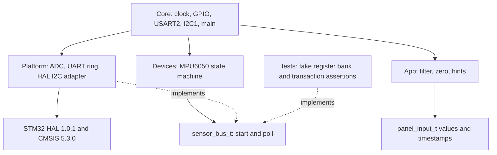

# Архітектура SunAlign

App і Devices не включають HAL, Core або Platform. `tools/check_architecture.py` перевіряє include й апаратні ідентифікатори. `make test` запускає цю перевірку та компілює portable C окремим host GCC. Main є composition root, де поєднуються драйвер, адаптер і логіка.

Драйвер опитує WHO_AM_I, записує PWR_MGMT_1=0, CONFIG=3, ACCEL_CONFIG=0, витримує 100 мс через deadline і читає 6 байтів кожні 100 мс. Після помилки він відкидає дані, чекає 1 с та повторює ID. Callback bus.poll повертає PENDING або остаточний статус; платформний watchdog 20 мс завершує завислий transfer і скидає I²C перед повторним використанням буфера. Busy периферії також підлягає watchdog.

HAL 1.0.1 Mem_Read_IT містить синхронне очікування TC у фазі адреси регістра. У первинному Wokwi-запуску ця фаза не завершилася. Адаптер використовує HAL_I2C_Master_Transmit_IT для адреси регістра з STOP, потім HAL_I2C_Master_Receive_IT. MPU6050 зберігає вказівник регістра між цими транзакціями. Вендорський код не змінюється. Це явна STOP-separated послідовність, а не прихований repeated START.

ADC запускається без очікування EOC у циклі, обидва канали послідовно. Готовність перевіряється прапором, межа очікування 10 мс; публікується тільки завершена пара. PA4 HIGH охоплює пару вимірювань. HAL init/calibration/stop можуть містити обмежені очікування, а runtime не викликає HAL_Delay або HAL_MAX_DELAY. UART має кільцевий буфер 1024 байти, передачу й приймання через IRQ. За переповнення __io_putchar повертає EOF, нові байти відкидаються й tx_lost зростає. Сумарний burst журналу, статистики й export спричиняє втрати в S2/S3; потрібна політика backpressure.

Піни сенсорів, ADC й адаптація HAL містяться в Platform/board.c; початкова ініціалізація UART/I²C залишається в Core. .ioc актуалізований як опис pinout/clock, нова генерація CubeMX не заявляється. Після регенерації потрібно перевірити USER CODE та не дублювати ручну ADC-ініціалізацію Platform.

Нуль зберігається в RAM тільки після стабільної кнопки 30 мс і придатного вектора 0.8..1.2 g. Кут atan2(X,sqrt(Y²+Z²)) є відносним pitch у статичному режимі. Фільтр alpha=1/4 оновлюється лише на новому номері вимірювання. Помилка або stale понад 300 мс скидає фільтр і обидві підказки; після відновлення старі значення не домішуються. Нуль у RAM діє до reset; окреме явне збереження у Flash передбачене ЛР3, але успішний запис у Wokwi наразі не підтверджений. LEFT/RIGHT має пороги 15/8%, LOWER/RAISE 5/3°. При DARK світлова підказка вимкнена, нахил залишається доступним.

## ЛР3

Планувальник залишається кооперативним. `App/measure` задає absolute cadence зі skip, `App/calibration` перевіряє CRC і вибирає цілий слот, `Platform/observe` адаптує SysTick/Flash/stack. `serial_text` форматує лише потрібні integer/string поля без printf/heap. Основний код і фізичні UART/сенсори залишаються в попередніх шарах.

Чинна часова база — HAL SysTick з роздільністю 1 мс. Планування і внутрішні метрики використовують цю шкалу; субмілісекундний WCET і CPU load недоступні. Масковані тики можуть бути втрачені, тому годинний S2 додатково перевірено незалежними UART-кадрами VCD. Попередній варіант sampled16 на TIM3 дав розбіжності й залишений як історія, а не як чинний вимірювальний метод. I2C1 має пріоритет 1, USART2 2, SysTick 3.

RX є single-producer ISR / single-consumer foreground ring, 63 корисні entries із timestamps. TX має 1023 корисні bytes, volatile shared tail/count/busy та barrier перед публікацією. Індекси не мають двох авторів. PB0 опитується у panel 1 ms. ZERO містить timestamp першого LOW sample і прийняття після debounce. Цей інтервал не охоплює затримку до першого sample. PA7 змінюється при прийнятому ZERO, а VCD PB0-to-PA7 дає повну модельну реакцію. PA6 HIGH охоплює активний export до спорожнення TX та виклик Flash. Він не розділяє ці операції, якщо вони перекриваються.

Яскравість та кутова модель ЛР2 збережені без апроксимації atan2. MPU release тепер абсолютний, щоб тривалість I2C не накопичувалась у періоді. Експорт d копіює 32 точки в окремий snapshot, щоб оновлення історії під час повільної передачі не змішувало покоління. Нова d перезапускає поточний експорт. s намагається зберегти тільки явно заданий ZERO, журнал із 32 точок залишається у RAM. У пілотах SAVE ok=0. ERASE ff_words=0 bad=0 не доводить успіх HAL erase: ці початкові значення лишаються і при ранній помилці HAL. Причина потребує окремої перевірки. Час невдалої спроби не є фізичним часом стирання Flash.
