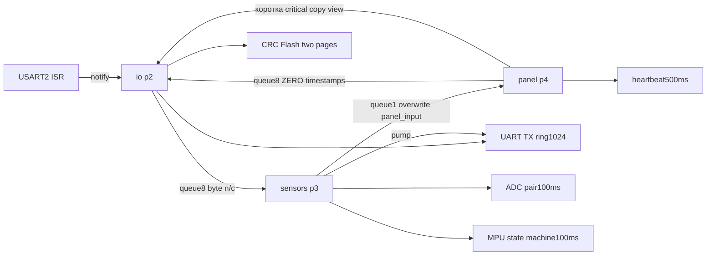

# SunAlign на FreeRTOS

## Власний продукт і розбиття

Два LDR PA0/PA1, MPU6050 I2C1 PB8/PB9, ZERO PB0, UART1152008N1, PA5 heartbeat. Прикладні App/sunalign, Devices/mpu6050 та двослотовий CRC store повторно використані з власної виміряної ЛР3. Середовище: Ubuntu 24.04, Docker, STM32 HAL, Wokwi. Nucleo-C031C6 не замінено.

| Задача | Пріоритет | Період / подія | Стек, слова | Обґрунтування |
|---|---|---|---|---|
| panel | 4 | vTaskDelayUntil 1 tick | 192 | ZERO debounce30ms/ціль50ms; heartbeat500ms/запізнення5ms; короткий шлях |
| sensors | 3 | vTaskDelayUntil 2ms (мінімум1tick), ADC/IMU cadence100ms | 192 | один власник неблокувальних драйверів, watchdog10/20ms і retry1s |
| io | 2 | UART notify або timeout1tick | 256 | command target10ms; serial writer, snapshot32 і Flash можна відкласти |
| IDLE | 0 | коли немає ready | 96 | запас CPU; без WFI через відомі обмеження моделі |

При tick100Hz сервісний квант10ms; cadence panel1ms навмисно лишається вимогою і фіксує пропуски. Це експеримент, не новий PRD.

М’ютекс шини в продукті не потрібен: I2C та ADC має одного власника sensors. Навмисна інверсія вимірюється окремим OS_DIAG1 з mutex/binary. queue1 передає найновіший повний знімок, не старі семпли. ZERO queue обмежена8 з zero_lost; n/c queue8 має sensor_cmd_lost. UART RX ring63 зберігає попередній контракт, ISR лише timestamp/байт/notify. TX має одного писача io; sensor тільки запускає передачу, ISR змінює tail.

## Ядро та час

Офіційний FreeRTOS-Kernel V10.5.1, MIT, copied kernel з VERSION.json (URL і SHA-256 завантаження). Порт GCC/ARM_CM0 для ARMv6-M Cortex-M0+, без FPU/DWT. ARM_CM4F із прикладу методички для цього MCU непридатний. На ARMv6-M немає BASEPRI: критичні секції порту застосовують PRIMASK для всіх маскованих IRQ. I2C1 priority1, USART2 priority2, PendSV/SysTick lowest3. NVIC priority grouping Cortex-M4 не застосовується до C031.

Preemption/time-slicing on; heap_4 4800B, tasks створюються тільки при init, kernel stack checking2, malloc/stack/assert fatal output. configUSE_TIMERS0: продукт не потребує timer daemon. Run-time stats увімкнено, форматування вручну через serial_text, без sprintf/malloc і newlib reentrancy. Вивід o лише після вимірюваного інтервалу. У RAM heap4800 вже врахований у bss; стеки задач розміщені всередині heap, тому їх не додають до RAM вдруге. MSP має окремий резерв2048, libc heap512 з попереднього linker.

HAL і FreeRTOS свідомо використовують один SysTick wrapper: до старту kernel звичайний HAL_IncTick на1ms; після старту increment HAL на1000/tick_hz ms і kernel handler. Запуск перемикається з IRQ disabled перед scheduler, щоб tick не викликав ядро до ініціалізації. Це явно обґрунтована альтернатива перенесенню HAL на TIM: HAL_GetTick зберігає ms, runtime HAL_Delay не використовується. При100Hz HAL timeout має квант10ms; це входить до результату експерименту. Внутрішній observe лишає1ms-format ЛР3, незалежний VCD перевіряє MCU progress. Runtime stats дослідженої конфігурації використовують атомарний HAL_GetTick()*1000 у32bit us (роздільність1ms при1000Hz,10ms при100Hz), без власних PRIMASK snapshots; інтервал обмежений71.58min, S2 одна година з невеликим margin. Після wrap kernel32bit stats потребуватимуть нової сесії; довша робота не заявляється.

PA8/PA9 encode0idle/1panel/2sensor/3io, PA10 tick; первинні D3 ADC, D4 PB0, D6 export/store, D7 acceptance збережені. VCD категорії включають ISR всередині і kernel calls; це не чиста корисна CPU робота. Runtime stats теж включають IRQ, які сталися під поточною задачею. Тривалість тіку з VAL охоплює wrapper/kernel і не включає PendSV після виходу. Context/ISR-task costs — окремий OS_DIAG6 з тією самою версією ядра/портом,100 подій кожного типу; програмно pending EXTI — не зовнішній фізичний фронт.

## Сумісність

Старі c/n/t/v/r/d/s та BOOT/PANEL/POINT/ZERO/SAVE/STAT/SCHED/RES/DEADLINE/EXPORT_DONE лишені. Додано RTOS і o→TASK/OS. Експорт d повторно починає immutable snapshot, як у ЛР3; перевантаження TX видиме через tx_lost. FreeRTOS не збільшує baud rate і не замінює фізичну Flash успішною затримкою.
